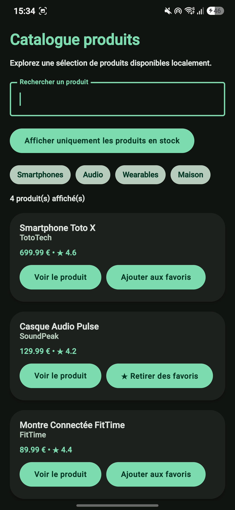
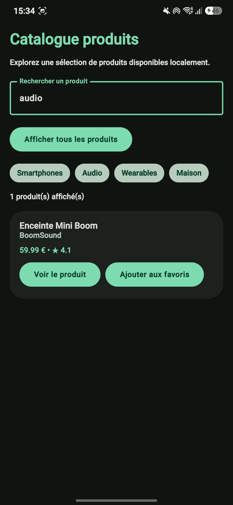
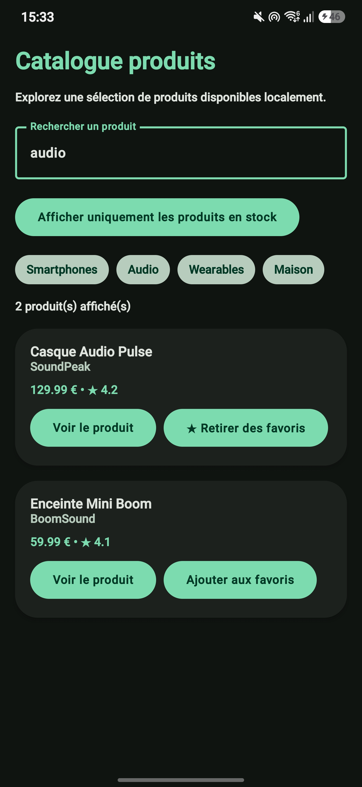

# Product Explorer

Application Android réalisée avec Jetpack Compose dans le cadre d'un TP à l'ESGI en Mastère 1.

## Description

Product Explorer affiche des produits à partir de données locales (`ProductUi`).
L'application contient plusieurs écrans :

- **Accueil** (`ProductHomeScreen`) : un titre, une barre de recherche (aperçu), un produit mis en avant, les catégories et l'offre du jour
- **Catalogue** (`ProductCatalogScreen`) : la liste des produits avec une recherche, un filtre pour n'afficher que les produits en stock et un bouton pour ajouter aux favoris
- **Détail** (`ProductDetailScreen`) : l'image, le prix et la remise, la note, la description, la garantie, la disponibilité et un bouton "Ajouter au panier"

## Ce qui est utilisé

- Composants Compose : `Text`, `Button`, `Icon`, `Image`, `Card`, `OutlinedTextField`
- Layouts : `Column`, `Row`, `Box`, `Spacer`, `Surface`
- Listes : `LazyColumn` pour les produits et `LazyRow` pour les catégories
- Thème Material 3 en clair et en sombre (`colorScheme`, `typography`, `shapes`)
- Composables stateless : `ProductCatalogScreen` reçoit toutes ses données en paramètres et remonte les actions avec des callbacks
- `ProductCatalogViewModel` avec un `StateFlow` qui contient l'état de l'écran (`ProductCatalogUiState`) : la recherche, le filtre stock et les favoris
- `ProductCatalogContainer` qui fait le lien entre le ViewModel et l'écran

## Avancement

| TP   | État        |
|------|-------------|
| TP4  | ✅ Terminé |
| TP5  | ✅ Terminé |
| TP6  | ✅ Terminé |
| TP7  | ✅ Terminé |
| TP8  | ✅ Terminé |
| TP9  | ✅ Terminé |
| TP10 | ✅ Terminé |
| TP11 | ✅ Terminé |

## Sujets

Les sujets se trouvent à la racine du projet, dans le dossier `Sujet`.

## Résultat sur téléphone

  
  
  

## Auteur

Nolhan Marteau, M1 ESGI