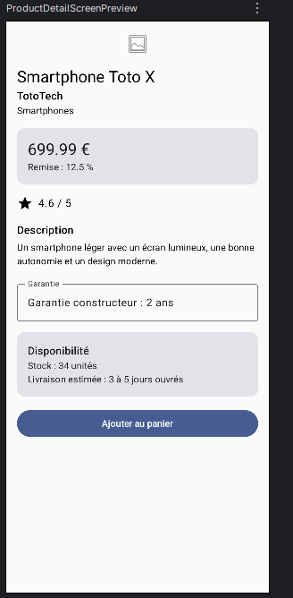
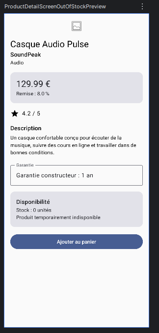
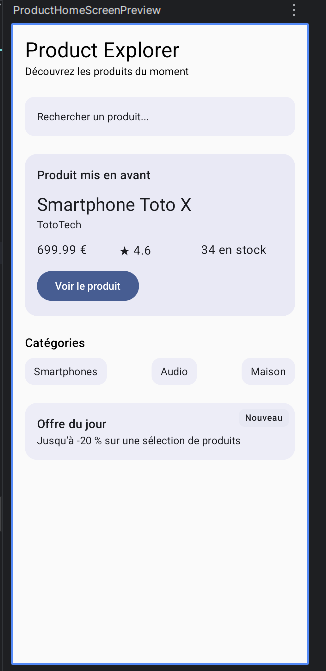

# Product Explorer

Application Android réalisée avec Jetpack Compose dans le cadre du bloc 2 « Compose UI ».

## Description

Product Explorer affiche des produits à partir de données locales (`ProductUi`).
L'application contient un **écran de détail produit** (TP4) et un **écran d'accueil** (TP5).
L'interface est découpée en petits composables réutilisables, qui reçoivent leurs données en paramètres.

## Avancement

| TP | Contenu | État |
|---|---|---|
| TP4 | Écran de détail produit | ✅ Terminé |
| TP5 | Écran d'accueil | ✅ Terminé |

## Écran de détail produit (TP4)

`ProductDetailScreen` affiche :

- l'image du produit (`ProductImage`) ;
- le titre, la marque et la catégorie (`ProductHeader`) ;
- le prix et la remise dans une carte (`ProductPriceCard`) ;
- la note avec une icône étoile (`ProductRating`) ;
- la description (`ProductDescription`) ;
- la garantie dans un champ en lecture seule (`ProductWarrantyField`) ;
- le stock et la livraison dans une carte (`ProductAvailabilityCard`) ;
- un bouton « Ajouter au panier » (`AddToCartButton`).
## Écran d'accueil (TP5)

`ProductHomeScreen` affiche :

- un en-tête avec le titre de l'application (`HomeHeader`) ;
- une barre de recherche visuelle (`SearchPreviewBar`) ;
- un produit mis en avant avec ses infos rapides (`FeaturedProductSection`, `ProductQuickInfoRow`) ;
- une ligne de catégories (`CategoriesSection`, `CategoryChip`) ;
- une offre du jour avec un badge « Nouveau » superposé (`DailyOfferBox`).
## Notions utilisées

- Composants fondamentaux : `Text`, `Button`, `Icon`, `Image`, `Card`, `OutlinedTextField`
- Layouts : `Column`, `Row`, `Box`, `Spacer`, `Surface`
- `Modifier` : `padding`, `fillMaxWidth`, `weight`, `align`
- Material 3 : `MaterialTheme.typography` et `MaterialTheme.shapes`
- Data class `ProductUi` et données d'exemple (`sampleProduct()`, `sampleProductOutOfStock()`)
- Callbacks pour les actions (`onAddToCartClick`, `onFeaturedProductClick`)
- Accessibilité : `contentDescription` sur l'image et l'icône
- Previews : écran d'accueil, produit en stock et produit en rupture de stock
## Preview

